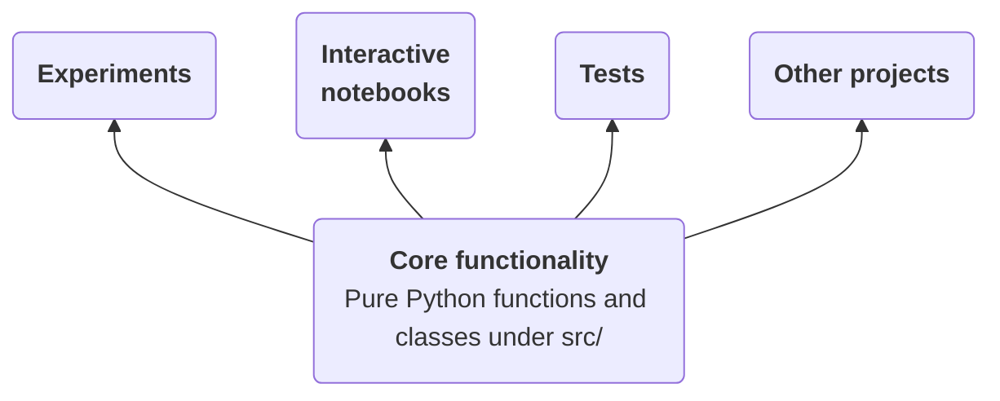
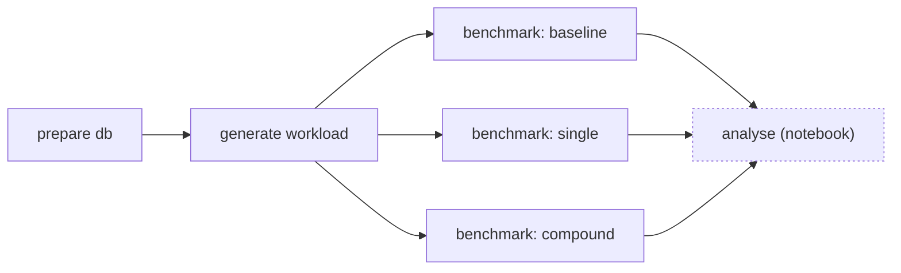

# Step 1: General Information

On this page we introduce the dataset and some general concepts related to the project.

## Dataset

We will use only [**Electric Vehicles**](https://huggingface.co/datasets/origami-ml/jsynth-data/viewer/electric_vehicles) dataset from [origami-ml/jsynth-data](https://huggingface.co/datasets/origami-ml/jsynth-data):
**189,010 records**, approximately **80.8 MB** (we only use the training split). 

The data contains information about registered electric vehicles in the state of New York, including details such as the city, zip code, county, vehicle make and model, and registration dates (represented as Unix epoch timestamps).

Here is an example document from the dataset: 

```json
{
  "_id": ObjectId("6ae2bf2d5e66d345c5bc1fb5"),
  "Record Type": "VEH",
  "Registration Class": "PAS",
  "City": "BROOKLYN",
  "State": "NY",
  "Zip": "11217",
  "County": "KINGS",
  "Model Year": 2021,
  "Make": "TESLA",
  "Body Type": "SUBN",
  "Unladen Weight": 4416,
  "Maximum Gross Weight": null,
  "Passengers": null,
  "Reg Valid Date": Long('1722297600000'),
  "Reg Expiration Date": Long('1792972800000'),
  "Color": "GY",
  "Scofflaw Indicator": "N",
  "Suspension Indicator": "N",
  "Revocation Indicator": "N"
}
```

The next step [2_preparation.md](2_preparation.md) will guide you through setting up the database and importing this dataset.


## Reusable code and experiments

This repo is organised as a proper Python package, with reusable core functionality as pure Python functions placed under the `src/` directory, with several "consumers" that make use of this core functionality, such as experiments, notebooks, and tests.




This separation is good software engineering practice, because you may want to re-use the core functionality at different layers: 

- In experiment scripts (e.g., `experiments/prepare_db.py`)
- In Jupyter notebooks for interactive use (see `notebooks/`)
- In tests for automated verification (`tests/`)
- In other python scripts, or even different projects if installed as a package

Try to avoid implementing additional functionality directly in the experiment scripts or notebooks. Instead, place reusable logic in the `src/` directory as helper functions or classes that can be imported and used across different layers.

## Yanex Experiment Graph

Yanex experiments can depend on each other (see [Dependencies](https://github.com/rueckstiess/yanex/blob/main/docs/dependencies.md) in the Yanex documentation). This allows you to package complex experiment workflows into pipelines or chains of experiments. 

Each experiment has its own parameters, metrics it can track and artifacts it can produce, like datasets, workloads or 
benchmarking results. Experiments further down in the chain can load artifacts from their predecessors (even transitively) as inputs and build upon them to produce new results.

Below is the experiment graph we will be using in this project:

- Workload generation depends on the database preparation step.
- Benchmarking experiments depend on the generated workload. We will benchmark 3 different index strategies, hence the three separate benchmarking nodes in the graph.
- Finally, we will analyse the results of all three benchmark runs. However, this is done in a separate Jupyter notebook (dotted border) and not as a Yanex experiment script (although it could be).





---

#### NEXT

Continue with [2_preparation.md](2_preparation.md), the database preparation step.